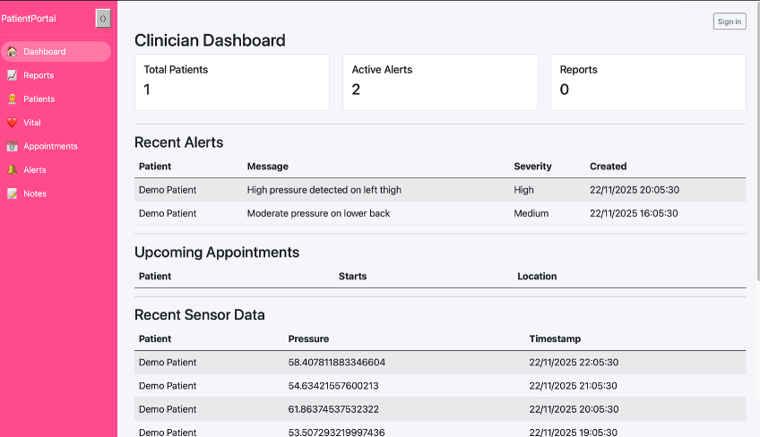
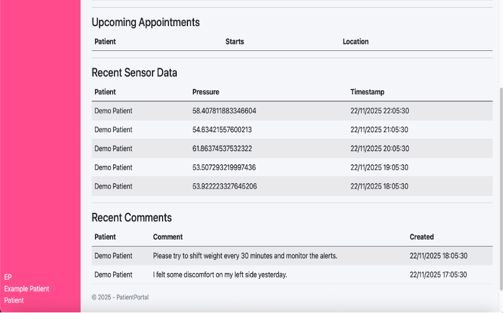
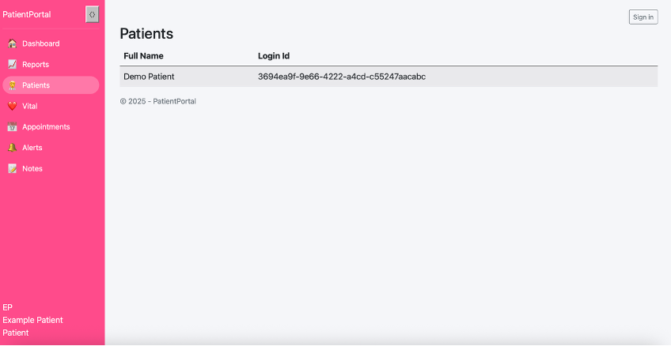
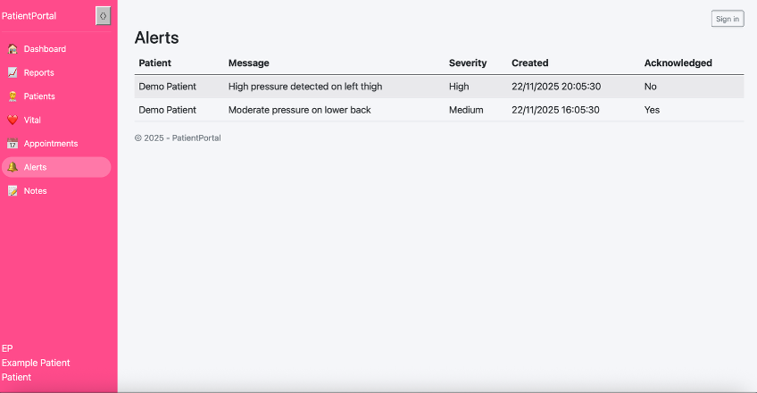
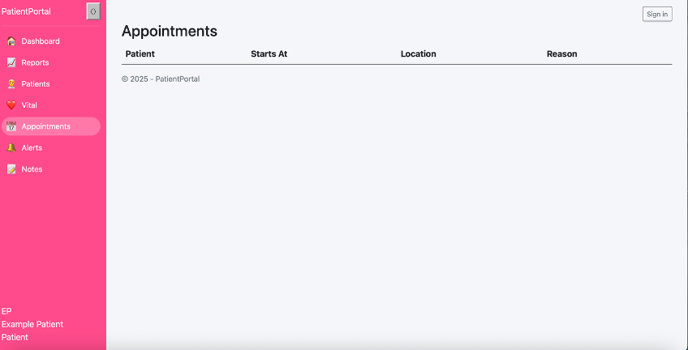
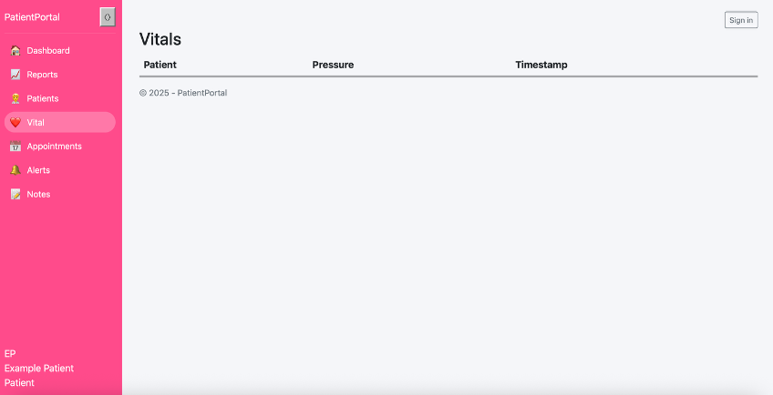
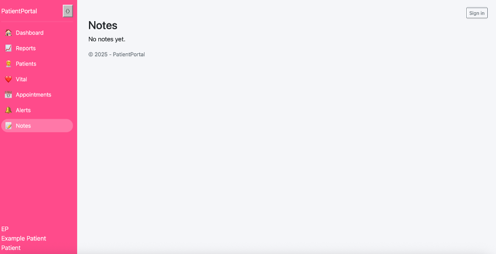
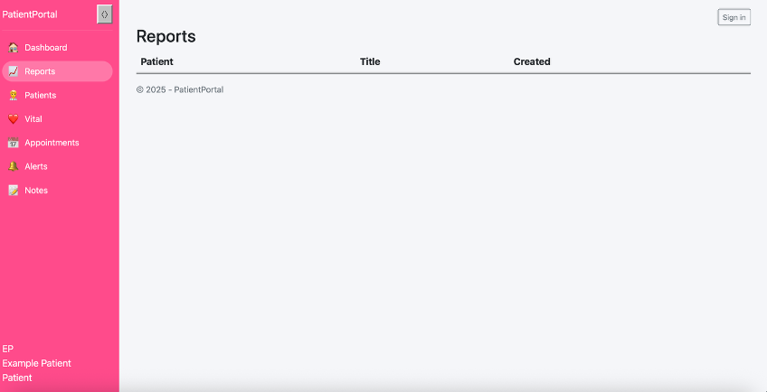

# Sensore – Healthcare Dashboard

## Project Overview

Sensore is a group software engineering project focused on developing a healthcare monitoring system to support patient care and help reduce the risk of pressure ulcers.
The application was developed using ASP.NET Core MVC and C#, with different interfaces designed for healthcare professionals, patients and administrators.

## My Contribution: Clinician Dashboard

My main responsibility within the group was developing the dashboard used by healthcare professionals to manage and monitor patient care.

## I worked on the following features:

* Dashboard: Built an interface that allows healthcare professionals to access important patient information.
* Patient Management: Worked on views and controllers for accessing medical records and patient details.
* Alerts: Developed functionality for displaying health alerts and monitoring notifications.
* Appointments: Worked on the appointment scheduling and management interface.
* Patient Vitals: Developed components for viewing vital signs and health measurements.
* Notes: Worked on pages for accessing and managing care notes.
* Reports: Developed reporting pages for reviewing patient information.
* Comments: Contributed to the comments interface.
 
## Technologies Used
* C#
* ASP.NET Core MVC
* Razor Views (CSHTML)
* Entity Framework Core
* HTML and CSS
* Rider IDE
  
## Repository Structure
The Sensore-My-Contribution folder contains selected source files from my individual contribution, including:
* Controllers/ – C# controllers for clinician dashboard functionality.
* Views/ – Razor views for clinician dashboard pages.
  
## Project Context
This project was completed as part of a university group software engineering assignment.
The repository highlights my individual contribution rather than presenting the entire group application as my own work.
Skills Demonstrated
* Full-stack web development
* MVC architecture
* C# programming
* User interface development
* Healthcare software design
* Team collaboration

## Project Screenshots

The following screenshots demonstrate the interfaces I worked on as part of the Sensore group project.

### Clinician Dashboard

### Patient Management

### Alerts and Appointments

### Patient Vitals, Notes and Reports

